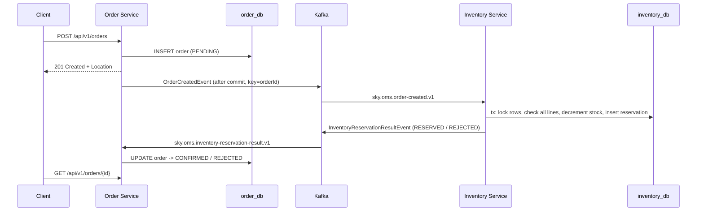

# SKY Order Management – Microservices

A small order management system built with **Java 21, Spring Boot 4.1, Apache Kafka and PostgreSQL**.
It has two services that talk to each other asynchronously through Kafka events.

| Service | Port | Responsibility | Database |
|---|---|---|---|
| `order-service` | 8081 | Create, get and list orders. Owns the order lifecycle (`PENDING → CONFIRMED / REJECTED`). | `order_db` |
| `inventory-service` | 8082 | Owns stock levels. Reserves stock for new orders and reports the outcome. | `inventory_db` |
| `sky-oms-common` | – | Shared **event contracts** (Java records) and topic names. No framework code. | – |

**Stack:** Java 21 (virtual threads enabled) · Spring Boot 4.1.1 (Spring Framework 7, Jackson 3, Hibernate 7) · Spring for Apache Kafka · PostgreSQL · Flyway · JUnit 5 + Mockito · springdoc-openapi 3.

---

## 1. How to run locally

### Prerequisites
| Tool | Version |
|---|---|
| JDK | 21 |
| Maven | 3.9+ |
| PostgreSQL | 14+ running on `localhost:5432` |
| Apache Kafka | 3.x / 4.x running on `localhost:9092` |

### Step 1: Create the databases (one time only)
```bash
psql -U postgres -f docs/create-databases.sql
```
This creates the user `sky`/`sky` and the databases `order_db` and `inventory_db`. Flyway creates the tables and seeds the demo stock when the services start.

> To use an existing user or database instead, set `DB_URL`, `DB_USERNAME` and `DB_PASSWORD` (see Configuration below).

### Step 2: Start Kafka (single node, KRaft mode, no ZooKeeper)
From your Kafka installation folder:
```bash
# first time only: format storage
KAFKA_CLUSTER_ID="$(bin/kafka-storage.sh random-uuid)"
bin/kafka-storage.sh format --standalone -t $KAFKA_CLUSTER_ID -c config/server.properties

# start the broker
bin/kafka-server-start.sh config/server.properties
```
On Windows, use the `bin\windows\*.bat` equivalents.
You don't need to create topics: each service creates the topics it owns (and their DLTs) on startup.

### Step 3: Build and run the tests
```bash
mvn clean verify
```
The unit tests don't need Kafka or PostgreSQL.

### Step 4: Start both services (two terminals)
```bash
mvn -pl order-service -am spring-boot:run
mvn -pl inventory-service -am spring-boot:run
```
You can also run `OrderServiceApplication` and `InventoryServiceApplication` directly from IntelliJ or Eclipse.

### Step 5: Try it
```bash
# Create an order -> 201 Created, status PENDING
curl -i -X POST http://localhost:8081/api/v1/orders -H "Content-Type: application/json" -d '{
  "customerId": "CUST-1001",
  "items": [
    {"sku": "SKY-GLASS-55",    "quantity": 1, "unitPrice": 649.00},
    {"sku": "SKY-STREAM-PUCK", "quantity": 2, "unitPrice": 39.99}
  ]}'

# A moment later the status is CONFIRMED (or REJECTED, with a reason)
curl http://localhost:8081/api/v1/orders/{id}

# Stock has gone down
curl http://localhost:8082/api/v1/inventory/SKY-GLASS-55
```
Demo stock: `SKY-GLASS-55` (10), `SKY-STREAM-PUCK` (100), `SKYQ-BOX-2TB` (25), `SKY-BROADBAND-HUB` (50), and `SKY-SOUNDBOX` (**0**, so you can test a rejected order).

More sample requests are in [`docs/requests.http`](docs/requests.http). You can run them directly from IntelliJ or VS Code.
- **Swagger UI:** http://localhost:8081/swagger-ui.html and http://localhost:8082/swagger-ui.html
- **Health:** `/actuator/health`

### Configuration (environment variables)

| Variable | Default |
|---|---|
| `DB_URL` | `jdbc:postgresql://localhost:5432/order_db` (or `inventory_db`) |
| `DB_USERNAME` / `DB_PASSWORD` | `sky` / `sky` |
| `KAFKA_BOOTSTRAP_SERVERS` | `localhost:9092` |
| `SERVER_PORT` | `8081` / `8082` |

You can tune retry and partition settings under `sky.oms.kafka.*` in `application.yml`.

---

## 2. Architecture



### Package structure (same layout in both services)

```
com.sky.ordermanagement
├── common.event / common.kafka        <- sky-oms-common: event records + topic names (the contract)
├── order                              <- order-service
│   ├── api            (controller, dto, error -> REST layer only)
│   ├── service        (use cases, transactions, mapping)
│   ├── domain         (JPA aggregate + business rules / state machine)
│   ├── repository     (Spring Data)
│   ├── messaging      (Kafka listener + publisher, thin adapters)
│   ├── config         (Kafka topics, error handling)
│   └── exception
└── inventory                          <- inventory-service (same layers)
```

### REST API

| Method | Path | Success | Errors |
|---|---|---|---|
| `POST` | `/api/v1/orders` | `201` + `Location` header | `400` validation or business rule, `415`, `500` |
| `GET` | `/api/v1/orders/{id}` | `200` | `400` invalid UUID, `404` |
| `GET` | `/api/v1/orders?customerId=&page=&size=` | `200` (paged, newest first) | `400` |
| `GET` | `/api/v1/inventory` / `/{sku}` | `200` | `404` |
| `POST` | `/api/v1/inventory/{sku}/restock` | `200` | `400`, `404`, `409` concurrent update |

All errors use **RFC 9457 `application/problem+json`**. Validation errors include an `errors` map of field → message. Unexpected errors return a generic `500` and never expose internal details.

---

## 3. Key design decisions and trade-offs

| Decision | Why | Trade-off |
|---|---|---|
| **Choreography saga** (events, no central orchestrator) | Only two services and one step. Each service reacts to the other's events, so coupling stays low. | The overall flow is implicit. With more steps (payment, shipping), an orchestrator would be easier to understand. |
| **Database per service** (`order_db`, `inventory_db`) | Each service owns its data. Neither reads the other's tables. | No cross-service joins or ACID transactions, so we rely on eventual consistency. |
| **PostgreSQL** instead of Couchbase | Stock reservation needs row locking and multi-row atomic updates, which a relational DB handles naturally. | The schema is more rigid. Migrations are managed with Flyway. |
| **`POST` returns `201` with status `PENDING`** | The order resource exists as soon as the request succeeds. Only the reservation happens asynchronously. The client polls `GET`. | `202 Accepted` is also defensible. Production would add webhooks or SSE so clients don't need to poll. |
| **Kafka message key = `orderId`** | All events for an order go to the same partition, so they stay in order. | An order cannot be spread across partitions (not a concern here). |
| **Publish after commit** (`@TransactionalEventListener(AFTER_COMMIT)`) | Consumers never see an order that was rolled back. | If Kafka is down at that moment, the event is lost. See limitations: the fix is an outbox. |
| **Idempotent consumers** | Kafka delivers *at least once*. Inventory stores one `reservations` row per `orderId`; a redelivery returns the stored outcome instead of decrementing stock again. Order ignores results for orders that are no longer `PENDING`. | Needs one extra table and a lookup per message. |
| **Inventory: commit, then send synchronously** | If the send fails, the listener throws. The offset is not committed and the record is redelivered. Because processing is idempotent, the stored outcome is simply published again, giving at-least-once delivery without an outbox. | The listener blocks on the send (bounded by `send-timeout-ms`). This is cheap because it runs on a virtual thread. |
| **All-or-nothing reservation with `SELECT … FOR UPDATE` ordered by SKU** | No partial reservations. Locking rows in a consistent order prevents deadlocks between concurrent orders. | Pessimistic locks reduce throughput on very hot SKUs. Alternatives are an optimistic `@Version` retry or a conditional `UPDATE … WHERE qty >= ?`. |
| **Retries + Dead Letter Topic** (`DefaultErrorHandler`, 3 × 1s, then `<topic>.DLT`) | A transient failure gets retried. A poison message doesn't block its partition forever. Errors that can never succeed (for example an unknown order) skip retries. | DLT messages need monitoring and a replay process (not built). |
| **`ErrorHandlingDeserializer` + Jackson 3 `JacksonJsonDeserializer`, no type headers** | Malformed JSON goes to the DLT instead of crash-looping. The contract is the JSON shape, not a Java class name. Unknown fields are ignored, so producers can add fields without breaking consumers. | Breaking changes need a new topic version (`.v2`), which is why topic names are versioned. |
| **Shared `sky-oms-common` module** | One source of truth for event shapes and topic names, checked at compile time. | Couples the services' release cycles. At larger scale, use a schema registry (Avro or Protobuf) and generate code per service. |
| **Rich domain model** (`Order.create/confirm/reject`, `InventoryItem.reserve`) | Invariants live in one place and are unit-tested without Spring. | Slightly more code than anemic entities. |
| **Java 21 virtual threads** (`spring.threads.virtual.enabled=true`) | Tomcat requests and Kafka listener containers run on virtual threads, so blocking I/O (JDBC, the synchronous Kafka send) doesn't tie up platform threads. | Pinning can occur inside `synchronized` blocks in older drivers. This is not an issue at this scale. |
| **Client sends `unitPrice`** | Keeps the scope small. There is no pricing or catalogue service. | **Not trustworthy** in real life. Prices must come from a catalogue or pricing service. |

---

## 4. Testing

```bash
mvn test
```

| Test class | What it covers |
|---|---|
| `OrderTest` | Total calculation, empty or duplicate-SKU orders, non-positive qty or price, state machine (no double transition), reason defaulting and truncation |
| `OrderServiceTest` | Create persists `PENDING` and raises the event with the correct payload; confirm, reject, duplicate result ignored, unknown order |
| `OrderControllerTest` (`@WebMvcTest`) | `201` + `Location`, field-level `400`s, malformed JSON, invalid UUID, missing param, `404`, `500` without leaking details |
| `InventoryItemTest` | Reserve and restock rules, stock unchanged on failure |
| `InventoryServiceTest` | Happy path, all-or-nothing rejection, unknown SKU, empty order, zero qty, repeated SKU lines aggregated, idempotent redelivery |
| `InventoryControllerTest` (`@WebMvcTest`) | `200`, `404`, `400` on restock |

---

## 5. Known limitations and next steps

1. **No transactional outbox in Order Service.** If Kafka is unavailable right after an order commits, the event is lost and the order stays `PENDING`. *Next:* write the event to an `outbox` table in the same transaction and relay it with a poller.
2. **No compensation or cancellation.** Reserved stock is never released (no cancel endpoint or reservation timeout). *Next:* `OrderCancelled` event → Inventory releases stock using the lines stored with the reservation.
3. **Security.** There is no authentication or authorization, and credentials are plain env vars. *Next:* OAuth2 resource server, externalised secrets, and TLS/SASL for Kafka.
4. **Observability.** Only logs carry the `orderId` (MDC) and `/actuator/health` is exposed. *Next:* Micrometer metrics.
5. **DLT replay tooling** is not implemented.
